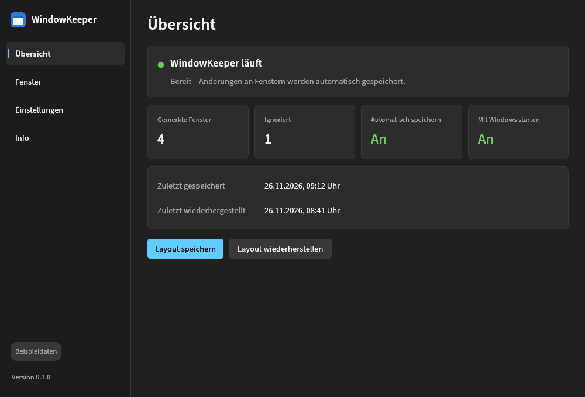
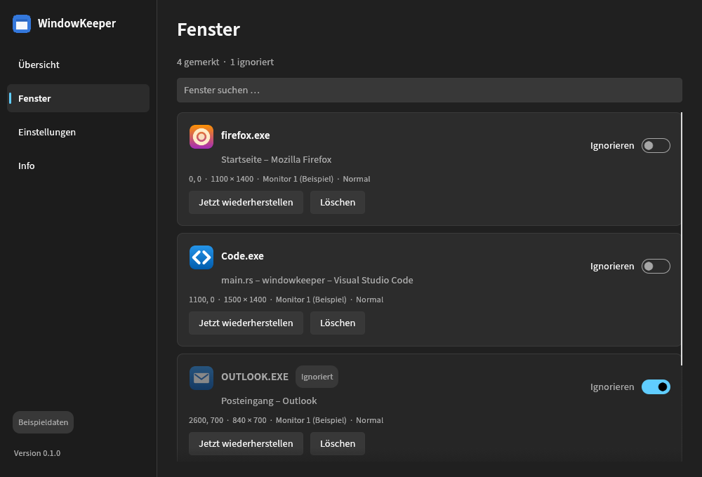
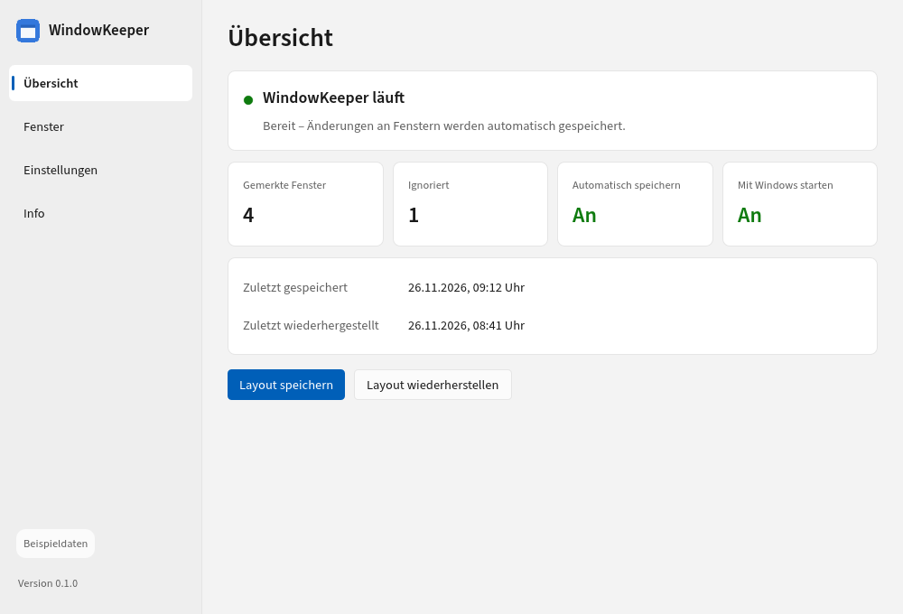
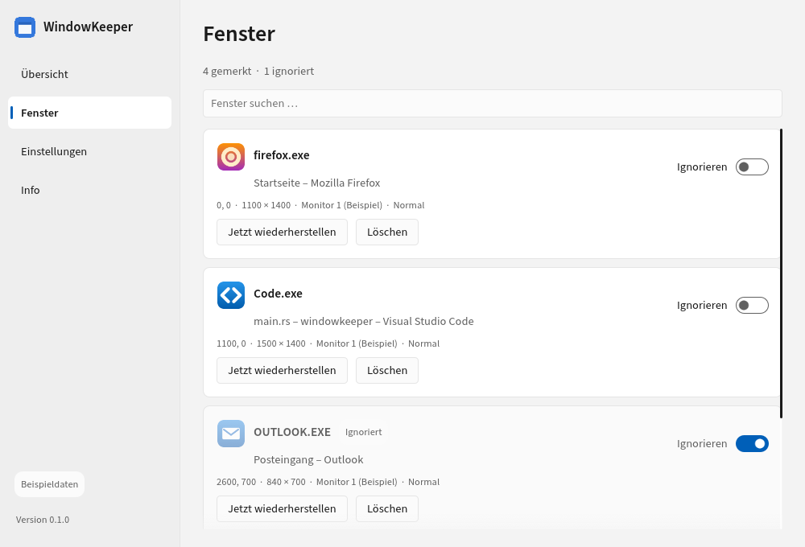
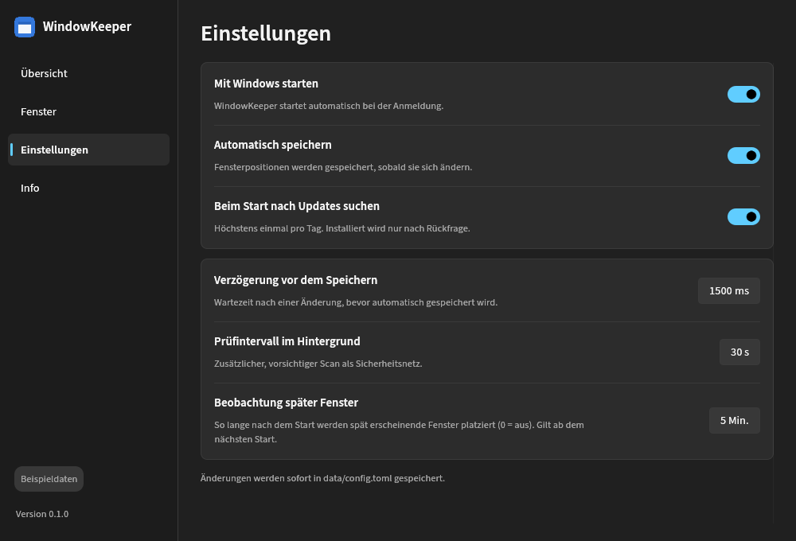
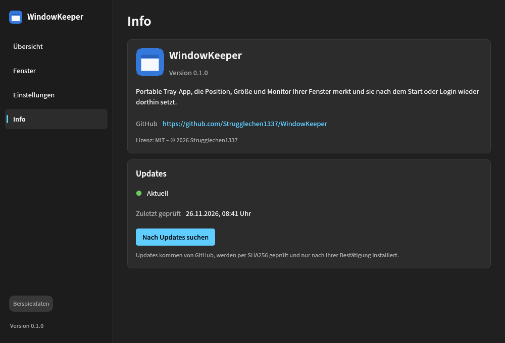
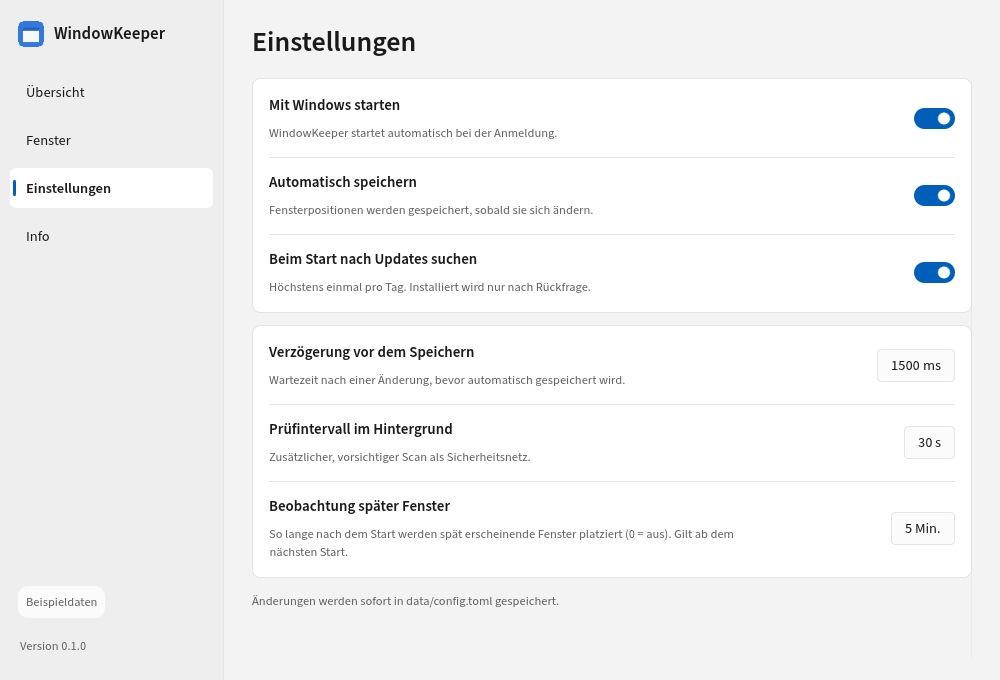
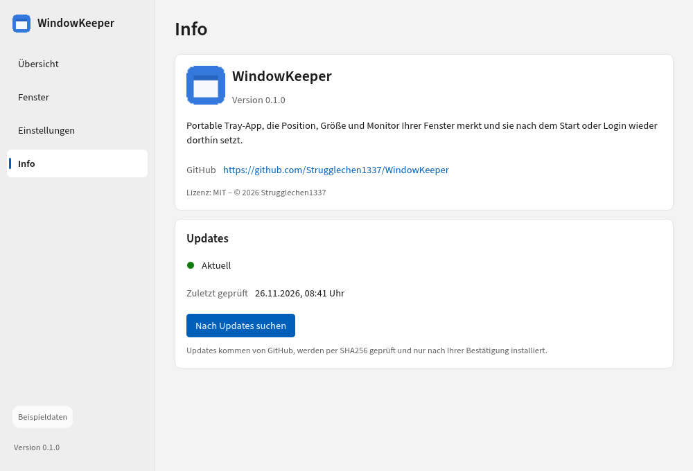

<div align="center">


# WindowKeeper

**Merkt sich, wo Ihre Fenster liegen – und stellt sie wieder her.**

[](https://github.com/Strugglechen1337/WindowKeeper/actions/workflows/ci.yml)
[](https://github.com/Strugglechen1337/WindowKeeper/releases/latest)
[](LICENSE)


</div>

<p align="center">
  
</p>
<p align="center"><sub>Alle Screenshots in dieser README zeigen <b>Beispieldaten</b> (erfundene Fenster, Zeiten und Update-Status), keine Live-Aufnahme eines echten Rechners.</sub></p>

WindowKeeper ist eine kleine, **portable Windows-Tray-App**. Sie merkt sich Position, Größe, Zustand (normal/maximiert/minimiert) und Monitor Ihrer Anwendungsfenster und setzt sie nach dem Start oder Login automatisch wieder dorthin – praktisch bei Ultrawide- oder Mehrmonitor-Setups, an Docking-Stations oder wenn Windows nach dem Aufwachen alles durcheinandergewürfelt hat. Eine einzelne EXE, kein Installer, keine Registry-Einträge (außer dem optionalen Autostart).

> **English in short:** WindowKeeper is a portable Windows tray app (single EXE, no installer) that remembers window positions, sizes and monitors and restores them at startup or login. It supports multiple monitors with per-monitor DPI v2, has a Windows 11 style overview GUI (German, light/dark), and a self-updater that verifies a SHA256 checksum. It never launches programs; it only repositions windows that are already running. Screenshots below show sample data.

## Screenshots

Dunkel und hell werden automatisch nach der Windows-Einstellung gewählt. *(Beispieldaten)*

| Übersicht | Fenster |
| :---: | :---: |
|  |  |
|  |  |

| Einstellungen | Info |
| :---: | :---: |
|  |  |
|  |  |

<sub>Die Bilder werden mit der echten Oberfläche unter Linux (Xvfb, Software-OpenGL) gerendert. Schrift (Source Sans Pro statt Segoe UI) und Programmsymbole (generierte Platzhalter statt der echten Symbole) weichen daher von Windows ab; die Daten sind frei erfunden. Neu erzeugen: <code>scripts/export_screenshots.sh</code>.</sub>

## Funktionen

- **Portabel:** eine einzelne `WindowKeeper.exe`, Daten im Ordner `data/` daneben.
- **Tray-App mit Autostart** (optional, per Schalter; schreibt nur `HKCU\...\Run`).
- **Layout bewusst speichern:** Du legst mit *Layout jetzt speichern* fest, welcher Stand gilt. Es gibt kein automatisches Speichern, das einen guten Stand überschreiben könnte.
- **Automatisch wiederherstellen** beim Start/Login mit dem zuletzt gespeicherten Layout. **Späte Fenster**, die erst nach einigen Minuten erscheinen (Standard: 10), werden ebenfalls platziert, und Apps, die ihr Fenster danach selbst wieder verschieben, werden mehrfach nachgeführt.
- Fenster werden über *Pfad der EXE + Fensterklasse* erkannt, bei generischen Klassen oder mehrdeutigen Treffern zusätzlich über den Titel.
- **Multi-Monitor und Per-Monitor-DPI v2.** Fehlt der gespeicherte Monitor (z. B. Display abgesteckt), landet das Fenster vollständig sichtbar im Arbeitsbereich des Hauptmonitors.
- **Übersicht (GUI)** auf Deutsch im Windows-11-Stil, hell/dunkel automatisch.
- **Selbst-Updater** über GitHub Releases mit Pflicht-SHA256-Prüfung; installiert nie ohne Rückfrage.
- Ignoriert werden Tool-Fenster, verdeckte („cloaked“) Fenster, UWP-Geisterfenster, hängende oder unsichtbare Fenster sowie WindowKeeper selbst.
- Es werden **keine Programme gestartet** – WindowKeeper positioniert nur Fenster, die bereits laufen.

## Download und Installation

Das aktuelle Release ist **[WindowKeeper 0.1.1](https://github.com/Strugglechen1337/WindowKeeper/releases/tag/v0.1.1)**.

1. [`WindowKeeper.exe`](https://github.com/Strugglechen1337/WindowKeeper/releases/download/v0.1.1/WindowKeeper.exe) herunterladen (zur Prüfung zusätzlich [`WindowKeeper.exe.sha256`](https://github.com/Strugglechen1337/WindowKeeper/releases/download/v0.1.1/WindowKeeper.exe.sha256)).
   Auf **Windows on ARM** (z. B. Snapdragon X) stattdessen die native `WindowKeeper-arm64.exe` mit `WindowKeeper-arm64.exe.sha256` aus dem jeweiligen Release laden (ab Version 0.2.0).
2. Die EXE in einen **beschreibbaren Ordner** legen (z. B. `C:\Tools\WindowKeeper\`).
3. Starten und im **Infobereich der Taskleiste** nachsehen (ggf. hinter dem Pfeil „Ausgeblendete Symbole“). Beim ersten Start erscheint ein Hinweis.

SHA256 von `WindowKeeper.exe` in v0.1.1: `ab3d54692894d9a4b0fcdc39e9e88efa4ec3e742ec127bc7bb5c8637dcc5f831`

Neuere Versionen finden Sie unter [Releases](https://github.com/Strugglechen1337/WindowKeeper/releases). Entwicklungsstände ohne Release liegen weiterhin als Artefakt **`WindowKeeper`** auf dem Tab [Actions](https://github.com/Strugglechen1337/WindowKeeper/actions/workflows/ci.yml) (GitHub-Login nötig).

Die EXE ist nicht code-signiert; Windows SmartScreen kann deshalb beim ersten Start warnen.

## Benutzung

- **Öffnen:** Linksklick (oder Doppelklick) auf das Tray-Symbol oder im Rechtsklick-Menü **Übersicht öffnen**. Ist das Fenster schon offen, wird es nur nach vorn geholt.
- **Schließen:** Das Schließen des Fensters beendet WindowKeeper **nicht** – die App läuft im Tray weiter. Beenden geht nur über das Tray-Menü.
- **Übersicht:** Status, Zeitpunkt der letzten Speicherung/Wiederherstellung, Anzahl gemerkter und ignorierter Fenster, Schaltflächen *Layout speichern* / *Layout wiederherstellen*.
- **Fenster:** Liste aller gemerkten Fenster (Programmsymbol, Datei, Titel, Position/Größe, Monitor, Zustand) mit Suche. Pro Eintrag:
  - **Jetzt wiederherstellen** setzt nur dieses Fenster zurück (läuft das Programm nicht, erscheint ein Hinweis – es wird nichts gestartet).
  - **Ignorieren** lässt den Eintrag in der Liste (abgeblendet), aber er wird beim automatischen Wiederherstellen, bei *Layout wiederherstellen* und beim Speichern übersprungen bzw. nicht verändert.
  - **Löschen** entfernt den Eintrag nach Rückfrage. Ist das Fenster noch geöffnet, wird es beim nächsten Speichern erneut gemerkt – zum dauerhaften Ausschließen *Ignorieren* nutzen.
- **Einstellungen:** Autostart, Beobachtung später Fenster, Update-Prüfung beim Start. Änderungen werden sofort in `data/config.toml` gespeichert.
- **Info:** Version, GitHub-Link, Lizenz und *Nach Updates suchen* (Installation nur nach Rückfrage, SHA256-Prüfung Pflicht).

### Tray-Menü

| Eintrag | Wirkung |
| --- | --- |
| Übersicht öffnen | Öffnet die Oberfläche (auch per Linksklick auf das Symbol) |
| Layout jetzt speichern | Speichert alle aktuellen Fensterpositionen; dieser Stand wird beim Start wiederhergestellt |
| Layout jetzt wiederherstellen | Setzt gespeicherte Positionen sofort um |
| Mit Windows starten an/aus | Setzt/entfernt den Autostart-Eintrag |
| Nach Updates suchen | Prüft sofort auf eine neue Version |
| Beenden | Beendet WindowKeeper |

Ist noch kein Layout gespeichert, passiert beim Wiederherstellen nichts (es erscheint nur ein kurzer Hinweis).

## Portabel: der Ordner `data/`

Alle Einstellungen und Daten liegen im Ordner `data/` **neben der EXE** (wird beim ersten Start angelegt):

| Datei | Inhalt |
| --- | --- |
| `data/config.toml` | Einstellungen (TOML) |
| `data/layout.json` | Gespeichertes Fensterlayout (inkl. Ignorieren-Markierung) |
| `data/state.json` | Zeitpunkt der letzten Speicherung/Wiederherstellung |
| `data/windowkeeper.log` | Logdatei (auf ca. 512 KB begrenzt, rotiert nach `.log.1`) |

Nichts wird unter `%APPDATA%` abgelegt. Ist der EXE-Ordner nicht beschreibbar, weicht WindowKeeper als Notlösung auf den Temp-Ordner aus (im Log vermerkt). Zum „Deinstallieren“ genügt es, die EXE und den Ordner `data/` zu löschen (vorher den Autostart ausschalten).

### Einstellungen (`data/config.toml`)

```toml
restore_watch_minutes = 10    # so lange werden spät erscheinende Fenster platziert (0 = aus)
check_updates_on_start = true # beim Start höchstens einmal täglich nach Updates suchen
last_update_check = 0         # wird automatisch gepflegt
first_run_done = false        # wird automatisch gepflegt
```

## Autostart

„Mit Windows starten an/aus“ schreibt den Wert `WindowKeeper` unter
`HKCU\Software\Microsoft\Windows\CurrentVersion\Run` (Pfad zur aktuellen EXE, in Anführungszeichen). Das ist die **einzige** Stelle, an der WindowKeeper die Registry benutzt. Verschieben Sie die EXE, wird der Pfad beim nächsten Start automatisch korrigiert, sofern der Autostart aktiv ist.

## Updates

- Beim Start prüft WindowKeeper höchstens **einmal pro Tag** auf eine neuere Version; „Nach Updates suchen“ prüft immer.
- Es wird das Windows-Programm aus dem neuesten GitHub-Release geladen und gegen die veröffentlichte SHA256-Prüfsumme (`WindowKeeper.exe.sha256`) verifiziert. **Fehlt die Prüfsumme oder passt sie nicht, wird abgebrochen.**
- Installiert wird **nie ohne Rückfrage** (Windows-Dialog auf Deutsch).
- Ablauf: Die laufende EXE wird zu `WindowKeeper.exe.old` umbenannt, die neue an ihre Stelle gelegt und neu gestartet; die `.old`-Datei wird beim nächsten Start gelöscht.

## FAQ und Einschränkungen

- **Fenster mit Administratorrechten werden nicht erfasst.** Das geht nur, wenn WindowKeeper ebenfalls erhöht läuft.
- **Die Oberfläche braucht OpenGL 2.0** (praktisch jeder Grafiktreiber, aber nicht in jeder Remote-/VM-Sitzung). Ohne läuft WindowKeeper im Tray weiter und meldet das.
- **UWP-Apps** und manche andere Programme positionieren sich nach dem Start selbst und ignorieren die Wiederherstellung.
- **Programme werden nicht gestartet.** Läuft ein gemerktes Programm nicht, passiert nichts (ein automatisches Starten ist bewusst nicht implementiert).
- **Ignorieren oder Löschen?** *Ignorieren* schließt ein Fenster dauerhaft von Speichern und Wiederherstellen aus. *Löschen* entfernt nur den Eintrag; ein noch offenes Fenster wird beim nächsten Speichern wieder aufgenommen.
- Es gibt ein Layout pro Rechner-Konfiguration. Gespeichert wird nur auf Wunsch, ein Verschieben durch Windows (z. B. nach dem Abstecken eines Monitors) ändert das gespeicherte Layout also nicht.

## Aus dem Quellcode bauen

Voraussetzung: [Rust](https://rustup.rs) (stable, Edition 2021).

```powershell
git clone https://github.com/Strugglechen1337/WindowKeeper.git
cd WindowKeeper
cargo build --release
# Ergebnis: target\release\windowkeeper.exe

# Native ARM64-Version (Windows on ARM), auch per Cross-Build von x64 aus möglich:
rustup target add aarch64-pc-windows-msvc
cargo build --release --target aarch64-pc-windows-msvc
# Ergebnis: target\aarch64-pc-windows-msvc\release\windowkeeper.exe
```

Die Logik (Fenster-Matching, Monitor-Fallback, Versionsvergleich, Konfiguration, Updater-Parser) ist plattformunabhängig und lässt sich auch unter Linux testen:

```bash
cargo test
cargo fmt --check
cargo clippy --all-targets -- -D warnings
```

Die Tray-App selbst baut nur unter Windows. Die CI (`.github/workflows/ci.yml`) lädt die gebaute EXE zusätzlich als Artefakt `WindowKeeper` hoch. Ein Release (wie [v0.1.1](https://github.com/Strugglechen1337/WindowKeeper/releases/tag/v0.1.1)) entsteht, wenn ein Tag `vX.Y.Z` gepusht wird; der Workflow baut x64 und nativ ARM64 (Runner `windows-11-arm`) und lädt `WindowKeeper.exe`, `WindowKeeper-arm64.exe` sowie die jeweilige `.sha256` hoch. Der Selbst-Updater wählt automatisch die Datei zur eigenen Architektur.

### Screenshots neu erzeugen

Das optionale Feature `screenshots` baut die Oberfläche auch unter Linux (X11) und rendert sie mit erfundenen Beispieldaten:

```bash
scripts/export_screenshots.sh   # startet Xvfb, rendert nach docs/screenshots/
```

Der Windows-Build ist davon unberührt (das Feature ist standardmäßig aus und nur für Beispiel `export_screenshots` gedacht).

## Ideen für die Zukunft

- Optional die gespeicherten Anwendungen selbst automatisch starten (aktuell bewusst **nicht** implementiert).
- Mehrere benannte Layouts / ein Layout pro Monitor-Konfiguration.

## Lizenz

[MIT](LICENSE) – Copyright (c) 2026 Strugglechen1337
